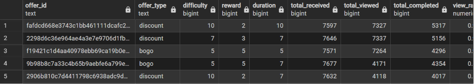

# CoffeeClub — PostgreSQL Optimization & Analytics

A SQL capstone for improving a migrated customer/offer database through relational constraints, indexes, data cleaning, feature engineering, and analytical views.

## Why it exists

A migrated database needs more than loaded tables: relationships must be enforced, missing values handled explicitly, and campaign activity made usable for reporting. This project implements those steps in PostgreSQL.

## Technology and implemented features

**PostgreSQL · SQL · B-tree indexes · relational constraints · analytical views**

- Primary and foreign keys across customers, offers, events, and offer channels.
- Indexes for common joins, filters, and customer/time queries.
- Derived day, hour, and interval features.
- Conversion of placeholder age 118 to NULL.
- Income and age groups that preserve unknown values.
- Views for offer activity, completion rankings, informational-offer transaction associations, and customer demographics.

## Repository structure

| File | Purpose |
|---|---|
| [schema_final.sql](schema_final.sql) | Inspection queries, schema changes, transformations, views, and evidence queries |
| [task3.1_offer_summary.png](task3.1_offer_summary.png) | Saved offer-summary screenshot |
| [Additional offer-summary screenshot](task3_offer_summary%20%282%29.png) | Additional saved query output |

## Query output examples



The screenshot is a saved example; this documentation update did not rerun the database or establish a performance benchmark.

## Setup and execution

Install PostgreSQL and a SQL client such as psql or pgAdmin. This repository assumes that the source data has already been migrated into the `coffee` schema; it does not include the initial schema creation or source data loader.

Before running, confirm these tables and columns exist:

| Table | Required columns used by the script |
|---|---|
| `coffee.customers` | `customer_id`, `gender`, `age`, `income` |
| `coffee.offers` | `offer_id`, `offer_type`, `difficulty`, `reward`, `duration` |
| `coffee.events` | `event_id`, `customer_id`, `offer_id`, `event`, `time` |
| `coffee.offer_channels` | `offer_id`, `channel_name` |

Use a disposable development copy: the script changes constraints and updates data. Duplicate keys, orphaned references, existing constraint names, or incompatible column types must be resolved first. The script is not fully idempotent.

```bash
git clone https://github.com/DevDataMLOps/CoffeeClub-Capstone.git
cd CoffeeClub-Capstone
psql -h localhost -U YOUR_USER -d YOUR_DATABASE -v ON_ERROR_STOP=1 --single-transaction -f schema_final.sql
```

Alternatively, inspect and execute the script in pgAdmin's Query Tool.

## Usage examples

Rank offers by completion rate:

```sql
SELECT *
FROM coffee.vw_offer_event_summary
ORDER BY completion_rate DESC NULLS LAST;
```

Inspect demographic aggregates:

```sql
SELECT *
FROM coffee.vw_customer_demographic_summary;
```

Inspect transactions associated with informational-offer viewing windows:

```sql
SELECT *
FROM coffee.vw_informational_offer_transaction_influence
ORDER BY influenced_transaction_count DESC;
```

## Interpretation and validation

Offer completion rates are ratios of event counts, rather than a deduplicated customer conversion funnel. Informational-offer results represent temporal associations: repeated or overlapping viewing windows may count the same transaction more than once. They do not establish causal campaign impact.

Index definitions demonstrate optimization techniques; no before/after latency improvement is claimed. Future work should add reproducible fixtures, integrity checks, and `EXPLAIN (ANALYZE, BUFFERS)` benchmarks.

## License status

This repository currently has no license file. A public repository alone does not grant an open-source reuse license.
